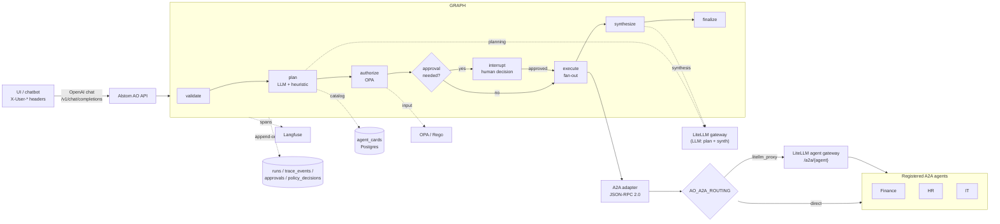

# Alstom AO — enterprise multi-agent orchestration layer

A production-oriented orchestration layer that sits between a UI and many
enterprise agents. It is exposed to the UI **as a virtual LLM model**
(`/v1/chat/completions`), routes each request to the right agents over **A2A**,
enforces **OPA** policy, pauses for **human approval when the intent is
consequential**, and traces every hop to **Langfuse** with dual identity.

> **Design stance:** the orchestration layer is infrastructure, not a prompt.
> Who may run, on whose behalf, with which version, at what cost, and how to prove
> it afterwards — those are the product.

---

## Contents

- [What it does](#what-it-does)
- [Architecture](#architecture)
- [Quickstart](#quickstart)
- [The agent registry](#the-agent-registry)
- [Dynamic routing](#dynamic-routing)
- [Human approval](#human-approval)
- [Policy (OPA)](#policy-opa)
- [Tracing and observability](#tracing-and-observability)
- [Dual identity](#dual-identity)
- [API](#api)
- [Configuration](#configuration)
- [Extending the platform](#extending-the-platform)
- [Production notes](#production-notes)
- [Tests](#tests)
- [Design lineage](#design-lineage)

---

## What it does

| Capability | Implementation |
|---|---|
| Central agent registry | Postgres `agent_cards`, mandatory identity/capability card |
| Dynamic routing | LLM planner (LiteLLM) **plus** deterministic heuristic fallback and hybrid merge |
| A2A protocol | JSON-RPC 2.0 `message/send` with legacy `tasks/send` fallback, agent-card discovery |
| LiteLLM agent gateway | Optional A2A routing through `POST /a2a/{agent}` with a virtual key, trace-header and protocol-version propagation |
| Robust "no agent" handling | Explicit `no_match`, `invalid`, `denied` terminal states with user-facing messages |
| Policy | OPA (`policies/*.rego`) with local fallback, `observe` / `enforce` modes |
| Human-in-the-loop | Dynamic risk assessment + LangGraph `interrupt`; survives restart with a Postgres checkpointer |
| Observability | One Langfuse trace per run, one span per node/agent, plus a durable `trace_events` ledger |
| Dual identity | User headers + service identity preserved into every agent call and trace event |
| Cost control | Per-run token/call/cost budget in the LLM gateway |
| Virtual model | OpenAI-compatible `/v1/chat/completions` (streaming and non-streaming) |
| Modular adapters | `AgentAdapter` ABC; A2A today, MCP/REST later without touching the orchestrator |

---

## Architecture



**Guarantees**

1. No agent is called unless it is registered, active, in the right environment,
   allowed by policy, and (when required) approved by a human.
2. The card version planned is the card version executed — snapshots are pinned
   into graph state before any approval pause.
3. Every terminal path produces a user-safe answer and an auditable trace.
4. A failing agent never fails the whole run silently; partial answers are
   labelled and failures are recorded.

---

## Quickstart

### Docker (Postgres + OPA + mock agents + API)

```bash
docker compose up --build
```

Then open <http://localhost:8080/docs>.

### Local, no API key, no Postgres

```bash
python -m venv .venv && source .venv/bin/activate     # Windows: .venv\Scripts\activate
pip install -e ".[dev]"
cp .env.example .env                                  # defaults: SQLite + mock LLM
python scripts/run_demo.py
```

`run_demo.py` starts three mock A2A agents and the API, asks a read-only finance
question, asks a write question (which pauses for approval), approves it, and
prints the audit timeline.

### First calls by hand

```bash
# read-only: routes to the finance agent, no approval
curl -s localhost:8080/v1/orchestrate \
  -H 'Content-Type: application/json' \
  -H 'X-User-Id: alice' -H 'X-User-Roles: user,finance' \
  -d '{"query":"Check invoice INV-2024-0912 for duplicate charges"}'

# write intent: returns status=awaiting_approval + approval_id
curl -s localhost:8080/v1/orchestrate \
  -H 'Content-Type: application/json' \
  -H 'X-User-Id: alice' -H 'X-User-Roles: user,finance' \
  -d '{"query":"Create an adjustment task for invoice INV-2024-0912"}'

# an approver decides; the paused graph resumes and executes
curl -s localhost:8080/v1/approvals/<approval_id>/decision \
  -H 'Content-Type: application/json' \
  -H 'X-User-Id: bob' -H 'X-User-Roles: approver' \
  -d '{"approved":true,"note":"checked with vendor"}'
```

Using it as a model from any OpenAI client:

```python
from openai import OpenAI

client = OpenAI(base_url="http://localhost:8080/v1", api_key="unused")
answer = client.chat.completions.create(
    model="alstom-ao",
    messages=[{"role": "user", "content": "How many days of annual leave do I get?"}],
    extra_headers={"X-User-Id": "alice", "X-User-Roles": "user"},
)
print(answer.choices[0].message.content)
```

---

## The agent registry

An agent cannot be integrated without a complete identity card. The registry is
the single source of truth for *who* an agent is and *what it may do*.

| Field | Purpose |
|---|---|
| `agent_id` | Stable identity (immutable, used in every trace) |
| `name`, `description` | Human + planner context |
| `platform`, `protocol`, `endpoint` | Where and how to call it (`a2a` today) |
| `owner`, `owner_contact` | Accountability |
| `capabilities`, `tags`, `examples` | Routing signal (planner + heuristic) |
| `input_schema`, `output_schema` | Contract |
| `auth` | `none`/`bearer`/`api_key`/`oauth2`, **secret reference only** (`env:NAME`) |
| `permissions` | Allowed roles, actions, scopes, data classification, approval triggers |
| `version` | Pinned into approvals and traces |
| `status`, `environment` | Lifecycle and environment gating |
| `risk_level` | Drives dynamic approval |
| `health` | Discovery probe result |

```bash
curl -X POST localhost:8080/v1/agents \
  -H 'Content-Type: application/json' \
  -H 'X-User-Id: admin' -H 'X-User-Roles: platform-admin' \
  -d @examples/agent_cards/finance-invoice-auditor.json
```

Register an existing A2A agent from its card:

```bash
curl -X POST localhost:8080/v1/agents/discover \
  -H 'Content-Type: application/json' \
  -H 'X-User-Id: admin' -H 'X-User-Roles: platform-admin' \
  -d '{"endpoint":"http://localhost:9101/agents/finance","environment":"dev"}'
```

Details: [docs/agent-card.md](docs/agent-card.md).

---

## Dynamic routing

1. **LLM planner** (through LiteLLM) receives the user request, the caller's roles,
   and a *closed catalog* of registered agents. It must return JSON and can only
   reference catalog ids.
2. **Validation** drops unknown agents, disallowed actions and duplicates.
3. **Heuristic planner** scores capability/tag/example overlap. It is used when
   the model is unavailable, returns invalid JSON, or is low-confidence; strong
   heuristic matches are merged with model picks (hybrid). A destructive intent is
   never silently downgraded to a read.
4. **No match is a first-class outcome**: `status=no_match` with a message listing
   what the environment *can* do. Nothing is invented.

Capabilities are also filtered by the caller's roles, so an agent the user could
never call never appears in the prompt.

---

## Human approval

Approval is **computed per request**, from:

- the action each agent will take (`read` vs `write`/`delete`/`payment`/`execute`);
- the agent's `risk_level` and `requires_approval_for`;
- policy obligations from OPA;
- the planner's own `requires_human_approval` judgement;
- explicit admin bypass (off by default).

A read-only question to a high-risk finance agent therefore runs immediately,
while "create an adjustment task" pauses. Destructive actions **always** pause,
even if the model forgot.

The graph pauses with LangGraph `interrupt()`, the run is persisted as
`awaiting_approval`, and the approval row survives restarts. Approving resumes
the graph from the exact paused state; rejecting ends the run without calling any
agent. Separation of duties is enforced by `policies/approval.rego`
(approver role, never self-approval).

Details: [docs/approvals.md](docs/approvals.md).

---

## Policy (OPA)

Every selected agent is authorized before execution:

```
POST {OPA}/v1/data/alstom/authz/decision
input = { user, service, agent, action, environment, request }
```

`policies/agent_authz.rego` checks: active status, environment, roles, allowed
actions, service scopes, tenant, data classification. It also emits the
`requires_approval` obligation.

Modes:

- `observe` — record the denial in the trace, continue (safe rollout).
- `enforce` — deny the agent; if every agent is denied the run ends `denied` with
  a clear message.
- If OPA is unreachable: use the local equivalent (`AO_POLICY_LOCAL_FALLBACK=true`)
  or fail closed in `enforce` mode.

Details: [docs/policies.md](docs/policies.md).

---

## Tracing and observability

One run = one Langfuse trace. Every node and every agent call is a span carrying
the common trace context:

| Field | Meaning |
|---|---|
| `workflow_id`, `trace_id`, `run_id`, `span_id`, `parent_span_id` | Correlation |
| `agent_id`, `agent_name`, `agent_version`, `protocol` | **Agent identity** |
| `initiated_by`, `authenticated_service` | **User + service identity** |
| `use_case`, `environment`, `action` | Intent and blast radius |
| `status`, `latency_ms`, `retry_count`, `error` | Outcome |
| `previous_agents`, `next_agents` | Chain of agents |
| `input`, `output` | What was asked, what came back |

The same context is sent to the downstream agent in the JSON-RPC `metadata`
**and** in `X-Alstom-*` headers, so a compliant peer joins the same trace.

Alongside Langfuse, the platform writes an append-only `trace_events` ledger in
Postgres (`GET /v1/runs/{id}/trace`), so the audit trail exists even if Langfuse
is down. `GET /v1/runs/{id}/timeline` returns the agent order.

Details: [docs/trace-context.md](docs/trace-context.md).

---

## Dual identity

| Identity | Source | Carried as |
|---|---|---|
| User | `X-User-Id`, `X-User-Email`, `X-User-Roles`, `X-User-Team`, `X-Tenant-Id` | run record, every trace event, A2A metadata |
| Service | `X-Service-Id`, `X-Service-Name`, `X-Service-Scopes`, `Authorization` (fingerprint only) | run record, every trace event, A2A metadata |
| Agent | registry card (never inferred) | trace context per invocation |

Tokens are never stored: only `sha256:<first16>` fingerprints. Agent credentials
are resolved from env at call time (`env:NAME`) and never persisted in the card.

---

## API

| Method | Path | Purpose |
|---|---|---|
| POST | `/v1/orchestrate` | Native orchestration |
| POST | `/v1/chat/completions` | OpenAI-compatible virtual model (SSE when `stream=true`) |
| GET | `/v1/models` | `alstom-ao` model listing |
| GET | `/v1/runs`, `/v1/runs/{id}` | Run listing / detail |
| GET | `/v1/runs/{id}/trace` | Full trace ledger |
| GET | `/v1/runs/{id}/timeline` | Agent order, latency, retries |
| GET | `/v1/runs/{id}/policy` | Policy decisions |
| POST/GET/PATCH/DELETE | `/v1/agents…` | Registry CRUD (writes: admin) |
| POST | `/v1/agents/discover` | Import an A2A agent card |
| GET | `/v1/agents/catalog` | Planner view |
| GET | `/v1/approvals` | Pending approvals |
| POST | `/v1/approvals/{id}/decision` | Approve/reject and resume |
| POST | `/v1/policies/evaluate` | Policy dry run |
| GET | `/v1/policies/status` | OPA reachability |
| GET | `/healthz`, `/readyz`, `/metrics` | Ops |

Details: [docs/api.md](docs/api.md).

---

## Configuration

All settings are `AO_*` environment variables; see [.env.example](.env.example).
Highlights:

| Variable | Default | Notes |
|---|---|---|
| `AO_DATABASE_URL` | `sqlite+aiosqlite:///./alstom_ao.db` | Postgres in production |
| `AO_LLM_MODE` | `mock` | `mock` or `litellm` |
| `AO_LLM_MODEL` | `openai/gpt-4o-mini` | Any LiteLLM model id |
| `AO_LLM_MAX_COST_USD_PER_RUN` | `0.50` | Budget guard |
| `AO_POLICY_MODE` | `observe` | `observe` or `enforce` |
| `AO_A2A_ROUTING` | `direct` | `direct` or `litellm_proxy` (agent gateway) |
| `AO_LITELLM_PROXY_URL` | `http://localhost:4000` | LiteLLM agent gateway base URL |
| `AO_LITELLM_PROXY_API_KEY` | unset | Virtual key; required in proxy mode |
| `AO_LITELLM_A2A_PROTOCOL_VERSION` | `0.3` | Wire format the gateway serves (`0.3` or `1.0`) |
| `AO_OPA_URL` | `http://localhost:8181` | Empty disables OPA |
| `AO_APPROVAL_ALLOW_SELF` | `false` | Keep false in production |
| `AO_LANGFUSE_ENABLED` | `false` | Set keys to enable |
| `AO_REQUIRE_USER_IDENTITY` | `true` | 401 when `X-User-Id` is missing |

---

## Extending the platform

### Route agents through the LiteLLM gateway

```bash
export AO_A2A_ROUTING=litellm_proxy
export AO_LITELLM_PROXY_URL=http://localhost:4000
export AO_LITELLM_PROXY_API_KEY=sk-alstom-master
```

Agent invocations then go to `POST /a2a/{agent_name}` on the gateway, while
registry, policy, approvals and tracing stay in this service. Details, naming
rules and a config exporter: [docs/litellm-a2a.md](docs/litellm-a2a.md).

### Add a protocol (MCP, REST, gRPC)
```python
# src/alstom_ao/adapters/mcp.py
class MCPAdapter(AgentAdapter):
    protocol = "mcp"

    async def invoke(self, card, request): ...
    async def check_health(self, card): ...
    async def discover(self, endpoint): ...

# factory.py
registry.register(MCPAdapter(settings))
```

Nothing else changes: the orchestrator resolves adapters by `card.protocol`.

### Add an agent

Register a card (or import an A2A card) and give it capabilities, permissions and
a risk level. No code change, no redeploy of the orchestrator.

### Add a policy rule

Add a rule to `policies/agent_authz.rego` and mirror it in `local_decision()` if
you rely on the offline fallback. Decisions are recorded either way.

---

## Production notes

- **Schema**: `alembic upgrade head` (or `AO_DB_AUTO_CREATE=true` for dev).
- **Agent routing**: `AO_A2A_ROUTING=litellm_proxy` requires the gateway to be
  reachable and a virtual key to be configured; the gateway then owns upstream
  agent credentials, logs and spend. Keep the registry authoritative and
  regenerate the gateway config with `scripts/export_litellm_agents.py`.
- **Durable pauses**: install the `postgres` extra
  (`langgraph-checkpoint-postgres`, `psycopg[binary]`) so an approval pause
  survives a process restart. Without it the run/trace/approval ledger survives,
  but the in-flight graph is held in memory.
- **Identity trust**: the platform trusts `X-User-*` headers. Terminate auth at
  the edge and strip these headers from untrusted clients, or set
  `AO_TRUST_FORWARDED_IDENTITY=false`.
- **Langfuse**: one trace per run; spans include `agent` observations so you can
  see fan-out. Tracing is best-effort and never blocks a run.
- **Budgets**: enforced in the gateway per run; a crash loop cannot outspend a
  limit because usage is persisted with the run.
- **Failure isolation**: a broken agent yields a labelled partial answer; a broken
  LLM gateway falls back to deterministic concatenation.
- **Metrics**: `/metrics` exposes counters (`ao.runs.*`, `ao.approvals.*`) without
  extra dependencies.

---

## Tests

```bash
python -m pytest -q      # 65 tests, hermetic (SQLite + fake A2A/gateway + mock LLM)
python -m ruff check src tests examples
```

Coverage includes: registry CRUD/authz, planner validation and hallucination
rejection, A2A message/legacy fallback/error mapping, **LiteLLM gateway routing
(target URL, virtual-key auth, trace headers, version pinning, no legacy
fallback)**, policy observe/enforce, approval approve/reject/expiry/self-approval,
OpenAI-compatible streaming, trace ledger dual identity, and end-to-end partial
failure.

---

## Design lineage

This platform deliberately combines production lessons from the reference
repositories:

| Source | What was adopted |
|---|---|
| `agent-template-orchestrator-advanced-langgraph` | Supervisor/specialist graph shape, human review queue, team isolation ideas |
| `OmishaPatel-Multi-Agent-Orchestrator` | Langfuse + LangGraph tracing, hybrid checkpointing mindset |
| `multi-agent-orchestrator` (awslabs) | Intent classifier contract, agent abstraction, streaming surface |
| `loomvault` | Durable replay mindset, per-run budget with explicit strategies, no double-billing |
| `orloj` | Policy/approval resources, A2A JSON-RPC semantics, declarative governance |
| LiteLLM agent gateway docs | A2A proxy surface (`/a2a/{agent}`), virtual-key auth, wire-format pinning, trace-header propagation |
| `OPA` | Rego decision points, fail-closed authorization |
| `nod` | Approval-before-acting UX and trust as a first-class feature |

---

## License

MIT. See [LICENSE](LICENSE).
