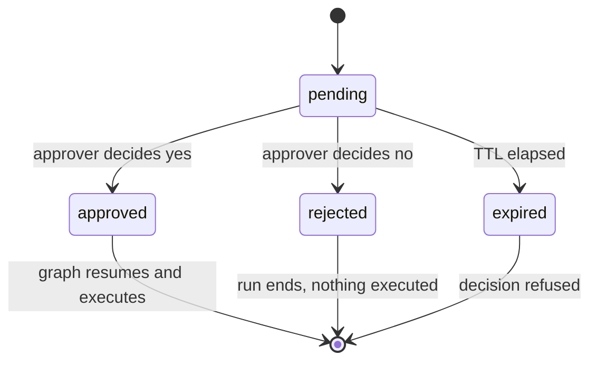

# Human approval

## Why it is dynamic

A static "this agent needs approval" flag is either too slow (every read pauses)
or unsafe (a write slips through). Approval here is computed per request from
several independent signals, so a read-only question to a high-risk agent is fast
while a consequential action always pauses.

## Signals

| Signal | Source |
|---|---|
| Action | planner (`read`, `query`, `analyze`, `write`, `update`, `delete`, `send`, `execute`, `payment`) |
| Agent risk | card `risk_level` |
| Card triggers | `permissions.requires_approval_for`, `permissions.high_impact_actions` |
| Policy obligation | OPA `obligations.requires_approval` |
| Planner judgement | `requires_human_approval` + reason |
| Roles | admin bypass (explicitly off by default) |

**Hard guardrails** (win over the model): `delete`, `payment`, `execute` always
require approval. A `high` risk agent requires approval for `write`/`update`/
`send`/… but not for `query`/`read`/`analyze`.

## State machine

`runs.status` mirrors this: `awaiting_approval` → `completed` / `rejected`.

## Flow

1. `authorize` node passes → `approval_gate` computes the assessment.
2. If required, `ApprovalService.get_or_create` persists a row (idempotent, one
   per run) and records `approval.requested`.
3. LangGraph `interrupt()` parks the run. The checkpointer persists state
   (including pinned card versions).
4. `POST /v1/approvals/{id}/decision`:
   - policy checks the actor (`policies/approval.rego`): approver role required,
     self-approval refused;
   - the decision is written;
   - `RunService.resume` re-invokes the graph with `Command(resume=…)`;
   - the graph continues to `execute`, then `synthesize`.
5. On rejection the run ends `rejected` with a clear message and **no** agent call.

## Restart safety

With the `postgres` extra installed, the checkpointer is
`AsyncPostgresSaver`: a paused run survives a process restart. Approvals are
always in Postgres, so the queue is not lost either way.

## Configuration

| Variable | Default |
|---|---|
| `AO_APPROVAL_TTL_MINUTES` | `120` |
| `AO_APPROVAL_RISK_THRESHOLD` | `high` |
| `AO_APPROVAL_ADMIN_ROLES` | `admin` |
| `AO_APPROVAL_ADMIN_BYPASS` | `false` |
| `AO_APPROVAL_ALLOW_SELF` | `false` |

## Operational tips

- Alert on `GET /v1/approvals` age > TTL, not just count.
- Show `reasons` to the approver verbatim — they are written for humans.
- Never enable `AO_APPROVAL_ALLOW_SELF` outside local demos.
