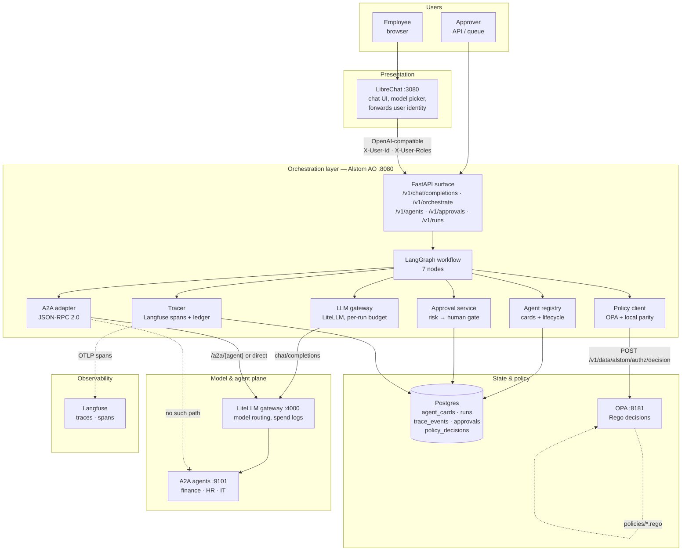
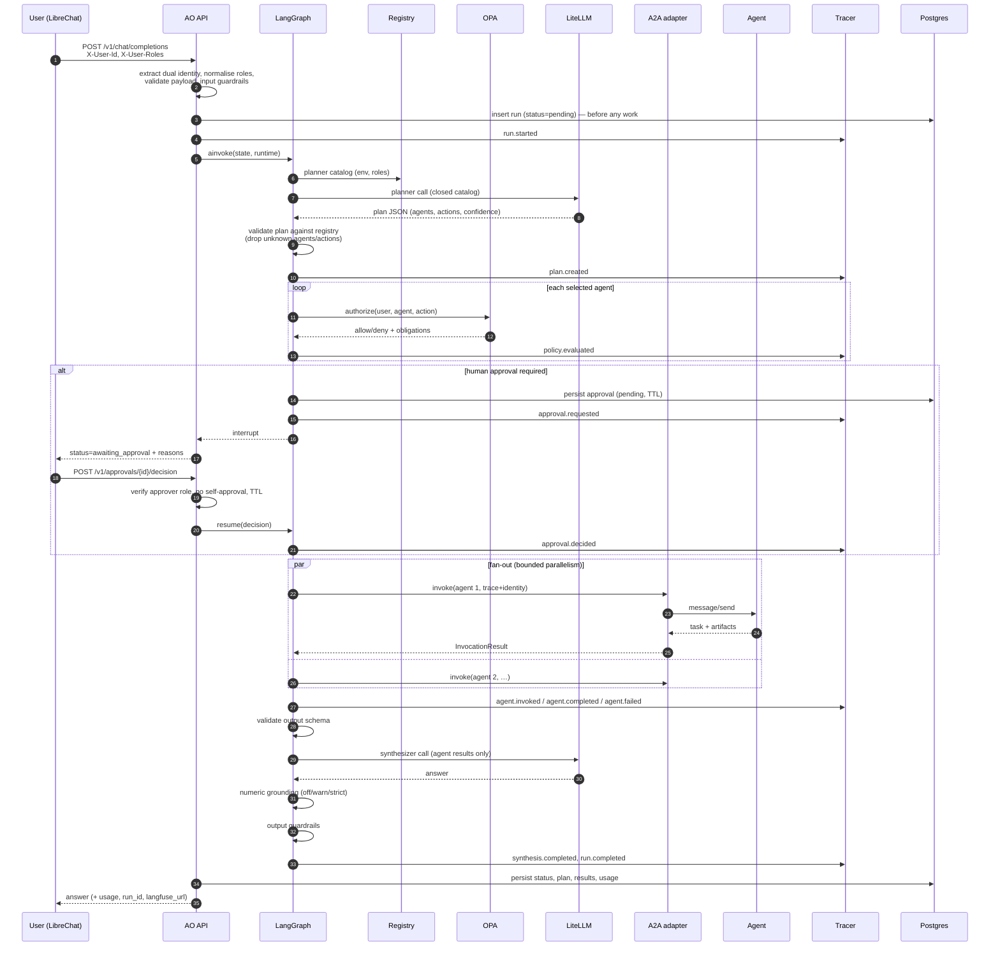
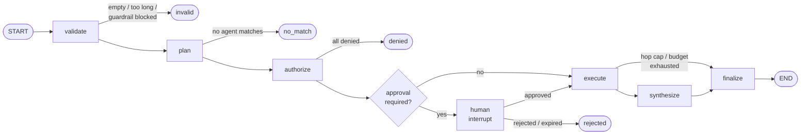
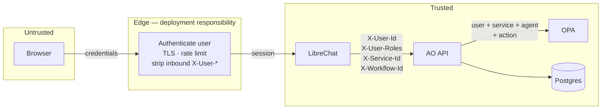
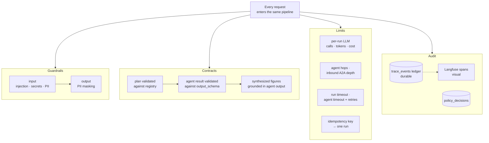

# Architecture review — Alstom AO end-to-end

Component-level view of the orchestration layer as deployed, with the
responsibility of every block and the file that implements it. Intended for
architecture review; each diagram is paired with a table so a reviewer can map a
box to code.

Deployed topology (verified running):

| Service | Port | Role |
|---|---|---|
| LibreChat | 3080 | end-user chat UI |
| Alstom AO API | 8080 | orchestration layer (this repo) |
| LiteLLM gateway | 4000 | LLM routing + A2A agent gateway |
| OPA | 8181 | policy decisions |
| Postgres | 5432 | registry, runs, trace ledger, approvals, Langfuse checkpoints |
| Mock A2A agents | 9101 | reference A2A peers (finance / HR / IT) |
| Langfuse | cloud | span-level tracing |

---

## 1. System context — who calls whom

### Block responsibilities

| Block | What it does | Where |
|---|---|---|
| **LibreChat** | Chat UI; presents the orchestration layer as a model spec ("Alstom Agents") with conversation starters. Substitutes the signed-in user into outbound headers. Never decides routing. | `LibreChat/librechat.yaml` |
| **FastAPI surface** | Two entry shapes over the same engine: native (`/v1/orchestrate`) and OpenAI-compatible (`/v1/chat/completions`, streaming SSE). Extracts dual identity, validates input, exposes registry/approval/run/trace endpoints. | `src/alstom_ao/main.py`, `api/routers/*` |
| **LangGraph workflow** | The decision engine. Seven nodes, conditional exits on every terminal outcome. Details in §3. | `orchestrator/graph.py` |
| **Agent registry** | Source of truth for *who* an agent is and *what it may do*: identity, capabilities, schemas, permissions, version, risk, environment, health. Also produces the role-filtered planner catalog. | `registry/service.py`, `db/repositories.py` |
| **Policy client** | Per-agent authorization before any call. Calls OPA; falls back to a local Python mirror of the same rules when OPA is unreachable. Records every decision. | `policy/service.py`, `policies/*.rego` |
| **Approval service** | Computes whether a human must approve, from actions + card risk + policy obligations + deterministic intent inference. Persists the request; supports expiry and separation of duties. | `approvals/service.py` |
| **LLM gateway** | Single path to models. Provider-agnostic via LiteLLM, with per-run budget, retries, fallbacks, and a deterministic mock for hermetic tests. | `llm/gateway.py` |
| **A2A adapter** | Calls agents over JSON-RPC 2.0 **through the LiteLLM gateway only**. Handles discovery, gateway auth, retries, idempotent ids and trace propagation. There is no direct path to an agent. | `adapters/a2a.py` |
| **Tracer** | One Langfuse trace per run with an `agent` span per invocation, plus an append-only `trace_events` ledger that survives Langfuse outages. | `observability/tracing.py` |
| **Postgres** | Registry + operational ledger + paused-run checkpoints + approval queue. Single durable store; SQLite in dev. | `db/tables.py` |
| **OPA** | Rego decisions: agent authorization and approver eligibility. Fail-closed option. | `policies/` |
| **LiteLLM gateway** | Model routing/spend logs for LLM calls; optional agent gateway (`/a2a/{agent}`) that owns upstream agent credentials. | `litellm/config.yaml` |
| **Langfuse** | Trace inspection for operators: spans, latency, token/cost per span. | external |

---

## 2. End-to-end request lifecycle

---

## 3. Inside the orchestration graph

| Node | Responsibility | Key decisions | File |
|---|---|---|---|
| **validate** | Reject unusable input before spending anything. Normalises query, enforces length cap, runs input guardrails (injection, secret requests, PII). | empty / too long / guardrail-blocked → `invalid` | `orchestrator/nodes.py` |
| **plan** | Ask the LLM planner (closed catalog) which agents to use; validate the answer against the registry; fall back to the deterministic heuristic when the model is unavailable, invalid, or low-confidence; merge multi-intent clauses. Pins the card **versions** into state. | no valid agent → `no_match` with the catalog described to the user | `orchestrator/planner.py` |
| **authorize** | Per agent: OPA decision on user + service + agent + action + environment. Fail-closed in `enforce`; records every decision for audit. | any denial removes that agent; all denied → `denied` | `policy/service.py` |
| **approval** | Deterministic risk assessment: destructive/financial actions always pause; card `risk_level` and `requires_approval_for`; policy obligations; planner opinion is advisory only for read-only plans. Persists the request, then `interrupt()`s. | paused → `awaiting_approval`; resume → execute or `rejected` | `approvals/service.py` |
| **execute** | Guards (delegation depth, hop cap, budget), then bounded fan-out over the selected agents. Validates each result against the card's `output_schema`. Never fails the whole run for one agent. | hop/budget stop → `finalize` with its own message | `orchestrator/nodes.py`, `adapters/a2a.py` |
| **synthesize** | One model call over agent results only, with numeric grounding (repair → redact → verbatim) and output guardrails. If the budget is spent, returns concatenated agent answers instead of discarding paid work. | — | `llm/grounding.py`, `llm/guardrails.py` |
| **finalize** | Terminal ledger entry; persists usage and the final status. Runs for every terminal path. | — | `orchestrator/nodes.py` |

---

## 4. Identity and trust boundaries

**Invariants**

1. Two identities are preserved end to end: the **user** (from headers) and the **service** (calling component). The **agent** identity comes from the registry card, never from the caller.
2. AO trusts `X-User-*` because the UI owns authentication. Deployments must terminate auth at the edge and strip inbound copies, or set `AO_TRUST_FORWARDED_IDENTITY=false`.
3. Roles are canonicalised to `admin` / `user` at the boundary; unknown names are dropped and the presented values retained for audit.
4. Ownership is enforced on reads: a run is visible to its owner, and to `admin`. Tenancy is enforced for `user` callers.

---

## 5. Cross-cutting

| Concern | Mechanism | Mode switch |
|---|---|---|
| Input/output guardrails | injection + secret-request block; PII/profanity warn; output PII masked | `AO_GUARDRAILS_MODE` |
| Output contracts | `jsonschema` Draft 2020-12 against card schema; prose = not applicable; external `$ref` rejected at registration | `AO_OUTPUT_SCHEMA_MODE` |
| Numeric grounding | every figure must exist in agent output or the question; repair → redact → verbatim | `AO_SYNTHESIS_GROUNDING` |
| Budgets | soft alert (alert + model downgrade) → hard gate that still returns collected results | `AO_LLM_MAX_*`, `AO_BUDGET_*` |
| Loop caps | agent hops per run; inbound delegation depth | `AO_MAX_AGENT_HOPS`, `AO_MAX_A2A_DEPTH` |
| Idempotency | `Idempotency-Key` + unique constraint; replay returns the original run | header |
| Access control | owner / admin scoping on runs, traces, approvals | `security/access.py` |
| Tracing | one trace per run, `agent` span per invocation, ledger as fallback | `AO_LANGFUSE_*` |
| Retention | `scripts/prune_trace_events.py`, never prunes pending work | CLI |

---

## 6. Failure and terminal states

| State | Trigger | What the user sees | Agent calls |
|---|---|---|---|
| `invalid` | empty/oversized query, guardrail block | specific reason | 0 |
| `no_match` | no registered agent fits | catalog hint of what exists | 0 |
| `denied` | policy denied all agents | which agents, which rule | 0 |
| `awaiting_approval` | consequential action | approval ID, risk, reasons | 0 |
| `rejected` | human said no | rejection note | 0 |
| `completed` | synthesis succeeded | answer (+ partial note if some agents failed) | n |
| `failed` | all agents failed, budget/hop stop, internal error | honest message, never fabricated | 0..n |
| `timeout` | run exceeded wall clock | timeout message | ≤n |

Design rule: **a terminal state is always persisted and always explained**; the reply never claims work that did not happen.

---

## 7. Questions for the reviewer

1. **Inbound A2A is not implemented.** Agent → orchestrator delegation has no server surface, so `AO_MAX_A2A_DEPTH` currently guards nothing. Is multi-hop mesh in scope, and if so who owns the agent card we publish?
2. **Approval is API-only.** The chat shows the approval ID and endpoint; there is no in-UI approve action. Acceptable for the pilot, or blocking?
3. **Two roles only (`admin`/`user`).** Business roles are not modelled; per-role agent filtering is effectively off for UI users. Confirm this is acceptable until the IdP mapping exists.
4. **`admin` is global and the sole approver.** That removes separation of duties except "cannot approve your own request". A single-admin org cannot approve its own writes. Intended?
5. **Agent credential custody.** `direct` mode holds agent secrets in AO; `litellm_proxy` mode moves them to the gateway. Which is the production stance?
6. **Honesty controls default to `warn`.** Grounding can be `strict`; guardrails can `block`. Which defaults should ship, given they change user-visible behaviour?
7. **No rate limiting** in AO. Should this live at the edge (ingress) or in the service?
8. **Agent accuracy is out of scope** of the proxy: grounding compares answer ↔ agent, so a wrong agent number is surfaced (cross-agent disagreement) but not corrected. Is upstream agent verification owned elsewhere?
