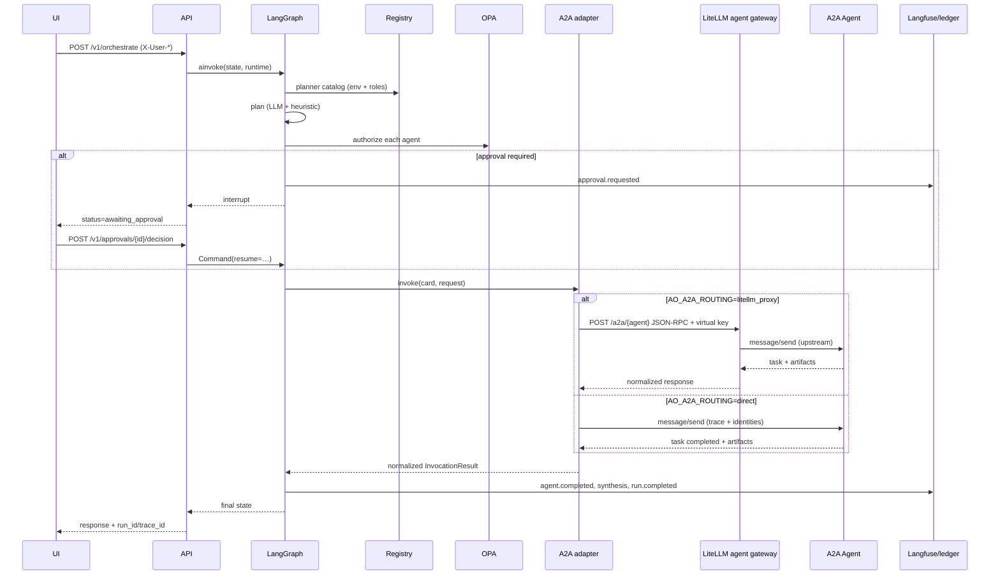

# Architecture

## Components

| Component | Responsibility |
|---|---|
| `api/` | HTTP surface: native orchestration, OpenAI-compatible model, registry, approvals, policy, runs, health |
| `orchestrator/` | LangGraph graph, planner, nodes, run lifecycle |
| `registry/` | Central card catalog, A2A import, planner catalog |
| `adapters/` | Protocol adapters (A2A today) behind one interface |
| `policy/` | OPA client + local parity rules |
| `approvals/` | Dynamic risk assessment + approval persistence |
| `llm/` | LiteLLM gateway, budgets, prompts |
| `observability/` | Langfuse spans + durable trace ledger + metrics |
| `security/` | Dual identity extraction, secret resolution |
| `db/` | Tables, repositories, session factory |

## Run sequence

## State

`OrchestratorState` holds only serializable data: query, identities (dicts),
catalog snapshot, plan, **pinned card snapshots**, policy decisions, results,
failures, response, status, usage. Runtime objects (gateway, budget, tracer) are
passed through `config["configurable"]["runtime"]`, never checkpointed, and rebuilt
on resume from the persisted run.

## Terminal states

| Status | Meaning |
|---|---|
| `invalid` | Empty/oversized query |
| `no_match` | No registered agent can help; message lists what exists |
| `denied` | Policy denied every selected agent (enforce mode) |
| `awaiting_approval` | Paused; nothing executed |
| `rejected` | Human said no |
| `completed` | Answer synthesized |
| `failed` | All agents failed, or an internal/LLM failure |
| `timeout` | Run exceeded `AO_RUN_TIMEOUT_SECONDS` |

## Numeric grounding

Prompt rules alone do not stop the synthesizer from doing arithmetic. In a live
run it turned "25 days per calendar year" plus "5 days after three years" into
"a total of **80 days**" — a number no agent ever reported.

So every generated answer is verified deterministically before it reaches the
user: each standalone number must already appear in an agent result, in the
agent's structured output, or in the question itself.

| Mode | `AO_SYNTHESIS_GROUNDING` | Behaviour |
|---|---|---|
| off | `off` | no check |
| warn | `warn` (default) | answer kept, caveat lists the ungrounded figures |
| strict | `strict` | answer replaced by verbatim agent output plus a reason |

Every ungrounded figure also emits `synthesis.ungrounded` with the grounded and
ungrounded sets, so drift is visible in the ledger and in metrics
(`ao.synthesis.ungrounded`).

What is deliberately *not* flagged: bare years (1900–2100, prose not quantity) and
anything inside an identifier (`INV-2024-0912`, `v2.3.0`, `PO-7781`, `2024-Q3`).
Matching is literal, so a model restating `4%` as `4.0%` would be flagged in
`strict` mode — that is the trade-off for a check that cannot invent.

The synthesizer prompt also gained explicit no-arithmetic and quote-verbatim
rules, but those are defence in depth: the verifier is what makes the guarantee.

## Failure isolation

| Failure | Behavior |
|---|---|
| One agent fails/times out | Run continues; answer notes which agent failed |
| All agents fail | `failed` with an explicit message |
| LLM planner fails | Heuristic planner (source marked `heuristic-fallback`) |
| LLM synthesis fails | Deterministic concatenation of agent answers |
| Langfuse down | Ledger still written; tracing skipped |
| OPA down | Local policy fallback or fail-closed (configurable) |
| Budget exceeded | Run fails with a budget message; usage persisted |

## Concurrency

Agents fan out with `asyncio.gather` bounded by `AO_MAX_PARALLEL_AGENTS`.
`previous_agents`/`next_agents` reflect **plan order**, which is the deterministic
logical chain even when calls overlap; actual start/finish order is in the ledger
timestamp order.
