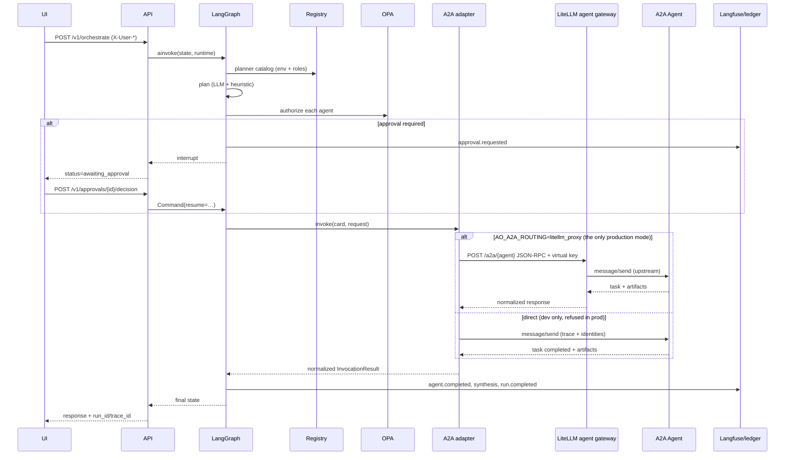

# Architecture

## Components

| Component | Responsibility |
|---|---|
| `api/` | HTTP surface: native orchestration, OpenAI-compatible model, registry, approvals, policy, runs, health |
| `orchestrator/` | LangGraph graph, planner, nodes, run lifecycle |
| `registry/` | Central card catalog, A2A import, planner catalog |
| `adapters/` | Protocol adapters (A2A today) behind one interface |
| `policy/` | OPA client + local parity rules |
| `approvals/` | Dynamic risk assessment + approval persistence |
| `llm/` | LiteLLM gateway, budgets, prompts |
| `observability/` | Langfuse spans + durable trace ledger + metrics |
| `security/` | Dual identity extraction, secret resolution |
| `db/` | Tables, repositories, session factory |

## Run sequence

## State

`OrchestratorState` holds only serializable data: query, identities (dicts),
catalog snapshot, plan, **pinned card snapshots**, policy decisions, results,
failures, response, status, usage. Runtime objects (gateway, budget, tracer) are
passed through `config["configurable"]["runtime"]`, never checkpointed, and rebuilt
on resume from the persisted run.

## Terminal states

| Status | Meaning |
|---|---|
| `invalid` | Empty/oversized query |
| `no_match` | No registered agent can help; message lists what exists |
| `denied` | Policy denied every selected agent (enforce mode) |
| `awaiting_approval` | Paused; nothing executed |
| `rejected` | Human said no |
| `completed` | Answer synthesized |
| `failed` | All agents failed, or an internal/LLM failure |
| `timeout` | Run exceeded `AO_RUN_TIMEOUT_SECONDS` |

## Numeric grounding

Prompt rules alone do not stop the synthesizer from doing arithmetic. In a live
run it turned "25 days per calendar year" plus "5 days after three years" into
"a total of **80 days**" — a number no agent ever reported.

So every generated answer is verified deterministically before it reaches the
user: each number must appear in an agent result, the agent's structured output,
or the question itself.

| Mode | `AO_SYNTHESIS_GROUNDING` | Behaviour |
|---|---|---|
| off | `off` | no check |
| warn | `warn` (default) | answer kept, caveat lists the ungrounded figures |
| strict | `strict` | **repair once** → redact only the offending sentences → verbatim agent text as last resort |

In `strict`, one extra model call asks for a rewrite without the offending
figures (`AO_SYNTHESIS_REPAIR_ATTEMPTS`, default 1). A repair that is degenerate
or still ungrounded is discarded — it can never launder a fabricated figure into
an accepted answer.

### Matching rules

Comparison is numeric, not textual:

| Case | Verdict |
|---|---|
| `4%` vs `4.0%`, `25` vs `25.0`, `1,200` vs `1200` | same quantity |
| `three years` vs `3 years` | same quantity |
| `policy 4.2`, `section 3.1.4`, `§ 7` | document reference, ignored |
| `INV-2024-0912`, `v2.3.0`, `PO-7781`, `2024-Q3` | identifier, ignored |
| bare years 1900–2100 | prose, not a quantity |
| `80` when agents reported `25` and `5` | **ungrounded** |

The tolerance only absorbs float formatting (1e-9 relative); it is far too tight
to hide real arithmetic.

### Agent-side visibility

Grounding compares the answer with the agent — it cannot detect a wrong agent.
What it can do is surface the problem instead of silently trusting it:

- **cross-agent disagreement** — two agents reporting different values for the
  same structured metric emits `agents.inconsistent` and adds a caveat naming the
  metric;
- **prose vs structured** — a figure in an agent's text that its own structured
  payload does not contain is recorded as `text_contradicts_structured`.

Both require agents to return structured numbers; prose-only agents produce no
check rather than noise.

### Event and metrics

`synthesis.ungrounded` (grounded + ungrounded sets + action taken),
`agents.inconsistent`, and counters `ao.synthesis.ungrounded`,
`ao.synthesis.repair_attempted`, `ao.agents.inconsistent`.

## Failure isolation

| Failure | Behavior |
|---|---|
| One agent fails/times out | Run continues; answer notes which agent failed |
| All agents fail | `failed` with an explicit message |
| LLM planner fails | Heuristic planner (source marked `heuristic-fallback`) |
| LLM synthesis fails | Deterministic concatenation of agent answers |
| Langfuse down | Ledger still written; tracing skipped |
| OPA down | Local policy fallback or fail-closed (configurable) |
| Budget exceeded | Run fails with a budget message; usage persisted |

## Concurrency

Agents fan out with `asyncio.gather` bounded by `AO_MAX_PARALLEL_AGENTS`.
`previous_agents`/`next_agents` reflect **plan order**, which is the deterministic
logical chain even when calls overlap; actual start/finish order is in the ledger
timestamp order.
