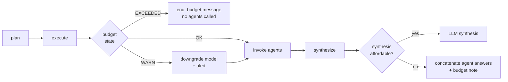

# Budgets and loop protection

Two different failure modes, two different mechanisms:

* **Money** — a run can spend more than intended. Handled by a tiered budget.
* **Loops** — a workflow can call agents forever without spending much per step.
  Dollars react too slowly to catch this, so hops and delegation depth are capped
  independently.

Mid-stream pause/resume was explicitly rejected: freezing an A2A task and waiting
for a manual top-up creates a long-lived state machine that has to survive
callbacks and timeouts. It is more failure surface than it saves.

---

## Tiers

| Tier | When | Behaviour | Config |
|---|---|---|---|
| **1. Soft alert** | any dimension ≥ `AO_BUDGET_SOFT_THRESHOLD` (default `0.8`) | `budget.warning` trace event, one webhook per dimension, metric counter. Run continues. | `AO_BUDGET_ALERT_WEBHOOK` |
| **2. Graceful downgrade** | same crossing, when a cheaper model is configured | the run's remaining LLM calls use `AO_BUDGET_DEGRADE_MODEL`; `budget.degraded` event records the switch | `AO_BUDGET_DEGRADE_MODEL` |
| **3. Hard gate** | any dimension reaches its limit | **new** work is refused: no agent is invoked, the run ends with a budget message. Agent results already collected are still returned. | `AO_LLM_MAX_*`, `AO_MAX_AGENT_HOPS` |
| **4. Hop / depth caps** | too many agent calls, or an inbound A2A call is too deep | plan is truncated to the highest-priority agents, or fan-out is refused outright | `AO_MAX_AGENT_HOPS`, `AO_MAX_A2A_DEPTH` |

### Why the hard gate is not a bare 429

A sub-agent that fails mid-workflow leaves the parent with nothing, wastes the
tokens already spent, and shows the user an error instead of a partial answer. So
`EXCEEDED` is enforced at the **graph boundary**:

* before any agent runs → nothing is invoked, clear budget message;
* after agents ran but before synthesis → the synthesis call is skipped and the
  collected agent answers are returned with an explicit budget note.



### Dimensions

| Dimension | Limit setting |
|---|---|
| `llm_calls` | `AO_LLM_MAX_CALLS_PER_RUN` |
| `tokens` | `AO_LLM_MAX_TOKENS_PER_RUN` |
| `cost_usd` | `AO_LLM_MAX_COST_USD_PER_RUN` |
| `agent_hops` | `AO_MAX_AGENT_HOPS` |

A limit of `0` means *unlimited* for that dimension. Evaluation is hard-limits
first, then soft thresholds, and the decision is pure data — the graph decides
what to do.

Usage survives restarts: it is persisted on the run and restored with
`LLMBudget.from_snapshot`, so a crash loop cannot reset the meter by dying often
enough. A paused run that already exhausted its budget **cannot be resumed** by
an approval (`429 budget_exceeded`).

---

## Loop protection

| Guard | Effect |
|---|---|
| `AO_MAX_AGENT_HOPS` | agent invocations per run. Beyond it the plan is truncated (priority order) and `hop.limit_hit` is recorded with the skipped agents. |
| `AO_MAX_A2A_DEPTH` | inbound delegation depth from `X-Alstom-Depth` / `X-A2A-Hop`. At the limit, fan-out is refused — this is what stops A → B → A chains. |
| `AO_PLANNER_MAX_AGENTS` | planner output cap, independent of budget. |

Peers should send `X-Alstom-Depth: <their depth + 1>` when delegating to us.

---

## Alerts

Fire-and-forget POST to `AO_BUDGET_ALERT_WEBHOOK` (Slack-compatible `text` field
plus structured fields):

```json
{
  "text": "[prod] Budget approaching on run run_…: cost_usd 0.4/0.5 (80%)",
  "event": "budget.warning",
  "run_id": "run_…",
  "dimension": "cost_usd",
  "used": 0.4,
  "limit": 0.5,
  "percent": 0.8,
  "model": "openai/gpt-4o-mini-cheap"
}
```

Alerts never block or fail a run; failures increment `ao.budget.alert_failed`.
One alert per dimension per run — not per token.

---

## Relationship to LiteLLM-side budgets

LiteLLM's proxy has its own `max_budget`/`budget_duration` and webhook support
for *its* traffic. Those are complementary, not duplicated:

| Layer | Sees | Good at |
|---|---|---|
| LiteLLM proxy | every model call through it, per key/team | org-wide spend caps, cost dashboards |
| This service | one run's plan, agents, hops, actions | per-run fairness, loop caps, graceful partial answers |

Use LiteLLM for organisation-wide ceilings and this service for per-run
guardrails. Both can be enabled at once.

---

## Known limits

* Agent-internal token spend is invisible to us: we bill our own planning and
  synthesis calls. A sub-agent's model usage must be capped by LiteLLM or by the
  agent itself.
* Limits are checked **before** a call and charged **after**, so one call can
  overshoot the cap by its own size.
* `DEGRADE` switches the model for the whole remaining run, not per step; per-step
  downgrade needs a model tier on the agent card.
* No `TRUNCATE`: dropping prompt context silently changes answer quality. Prefer
  failing a synthesis over silently answering a different question.
