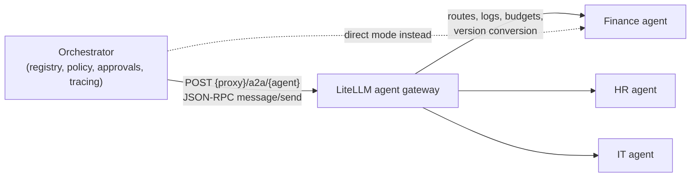

# LiteLLM agent gateway (A2A)

The orchestration layer can reach agents in two ways. The wire protocol is
identical in both; only the **address and credentials** change.

| Mode | `AO_A2A_ROUTING` | JSON-RPC target | Auth we send |
|---|---|---|---|
| Direct | `direct` (default) | `card.endpoint` | the agent's own `auth` block (`env:` secret) |
| LiteLLM gateway | `litellm_proxy` | `{AO_LITELLM_PROXY_URL}/a2a/{agent_name}` | LiteLLM virtual key |



## Why route through the gateway

- Central request/response logs and per-agent spend for **agent** traffic.
- Load balancing and provider fallbacks across agents.
- Protocol normalisation: the proxy can serve A2A `0.3` or `1.0` wire format to us
  while the upstream agent speaks either.
- One place to hold upstream agent credentials; our cards then only need the
  gateway name.

What does **not** move to the gateway: the registry stays the source of truth for
capability, ownership, permissions and risk; policy, approvals and tracing stay
in the orchestration layer. The gateway executes, we govern.

## Configuration

```env
AO_A2A_ROUTING=litellm_proxy
AO_LITELLM_PROXY_URL=http://litellm:4000
AO_LITELLM_PROXY_API_KEY=sk-alstom-master          # or:
AO_LITELLM_PROXY_API_KEY_REF=env:AO_LITELLM_VIRTUAL_KEY
AO_LITELLM_AGENT_PREFIX=/a2a
AO_LITELLM_A2A_PROTOCOL_VERSION=0.3                 # 0.3 | 1.0
AO_LITELLM_FORWARD_TRACE_HEADERS=true
```

The key is mandatory in proxy mode; a missing key fails fast with
`missing_proxy_key` instead of silently calling the wrong endpoint.

## Agent naming

The gateway addresses agents by the name they were registered under. Resolution
order:

1. `card.metadata.litellm_agent_name`
2. `card.agent_id`

So an existing card keeps working unchanged if the two names match. Use the
metadata field when the gateway name differs (e.g. `ij-local`).

## Wire details

| Concern | Proxy mode |
|---|---|
| Invocation | `POST {proxy}/a2a/{agent}` with `method: message/send` |
| Discovery | `GET {proxy}/a2a/{agent}/.well-known/agent-card.json`, then `/.well-known/agent.json` |
| Health probe | same discovery path (a card response means healthy) |
| Auth headers | `x-litellm-api-key: Bearer <key>` **and** `Authorization: Bearer <key>` |
| Version header | `A2A-Version: <AO_LITELLM_A2A_PROTOCOL_VERSION>` |
| Trace grouping | `X-LiteLLM-Trace-Id: <our trace id>`, `X-LiteLLM-Agent-Id: <agent name>` |
| Our own context | `X-Alstom-*` headers and `params.metadata` are still sent |
| Legacy fallback | disabled — the gateway has a fixed method set |

Because `X-LiteLLM-*` headers reach the agent, agent-side LLM calls made back
through LiteLLM group under the same trace, which is what makes per-run cost
attribution usable.

> **SDK note:** we deliberately speak JSON-RPC over HTTP rather than using
> `litellm.a2a_protocol`. That SDK module targets the pre-1.0 `a2a-sdk` API
> (`MessageSendParams`, `a2a.client.A2AClient`) which `a2a-sdk` 1.x removed; the
> gateway routes themselves require `a2a-sdk >= 1.1`. Talking to the HTTP surface
> avoids pinning a conflicting SDK in the orchestration service.

## Registering agents in LiteLLM

```yaml
# litellm/config.yaml
agents:
  - agent_name: finance-invoice-auditor
    agent_card_params:
      name: Finance Invoice Auditor
      url: http://mock-agents:9101/agents/finance
      version: 2.3.0
      protocolVersion: "0.3"
    litellm_params:
      api_key: os.environ/ALSTOM_AO_AGENT_KEY
```

Two registrations (our registry + the gateway) drift over time. Keep ours
authoritative and regenerate the gateway block:

```bash
python scripts/export_litellm_agents.py \
  --base-url http://localhost:8080 \
  --user-id admin --roles platform-admin \
  --out litellm/agents.generated.yaml
```

## Verifying

```bash
# gateway sees the agent
curl -s localhost:4000/v1/agents -H "Authorization: Bearer $LITELLM_MASTER_KEY"

# gateway serves the proxied card
curl -s localhost:4000/a2a/finance-invoice-auditor/.well-known/agent.json

# our health probe goes through the gateway in proxy mode
curl -s -X POST localhost:8080/v1/agents/finance-invoice-auditor/health \
  -H 'X-User-Id: admin' -H 'X-User-Roles: platform-admin'

# a run stores the gateway trace id on every span
curl -s localhost:8080/v1/runs/<run_id>/trace -H 'X-User-Id: alice' \
  | jq '.events[] | select(.agent_id != null) | {action, agent_id, trace_id}'
```

## Switching back

Set `AO_A2A_ROUTING=direct`. Nothing else changes: cards already carry their own
`endpoint` and `auth`, and every test covers both modes.
